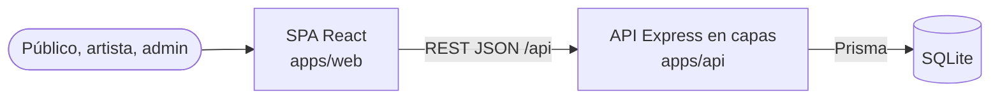
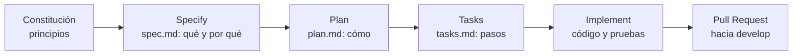

# Festival de Artes Vivas Loja

Prototipo web para el **Festival Internacional de Artes Vivas de Loja** (Ecuador). Permite
consultar la cartelera de funciones de teatro, danza, música, circo y artes de calle;
conocer las obras, los artistas y los escenarios de la ciudad; reservar entradas con
control de aforo y administrar la programación.

> Proyecto académico de la asignatura **Arquitectura de Software** — Universidad Técnica
> Particular de Loja (UTPL).

[](https://deepwiki.com/Camello15/festival-artes-vivas-loja)

**Documentación generada con DeepWiki:** https://deepwiki.com/Camello15/festival-artes-vivas-loja

---

## Contenido

- [El caso](#el-caso)
- [Equipo](#equipo)
- [Stack tecnológico](#stack-tecnológico)
- [Instalación y ejecución en local](#instalación-y-ejecución-en-local)
- [Estructura del repositorio](#estructura-del-repositorio)
- [Arquitectura](#arquitectura)
- [Metodología: Specification-Driven Development](#metodología-specification-driven-development)
- [Flujo de ramas](#flujo-de-ramas)
- [Video de sustentación](#video-de-sustentación)

## El caso

El festival reúne cada año a compañías nacionales e internacionales en varios escenarios
de Loja. El público necesita saber **qué hay, cuándo y dónde**, y asegurar su lugar en
funciones con aforo limitado. Los organizadores necesitan **mantener la programación** y
**controlar la asistencia**.

| Funcionalidad | Actor | Spec |
|---|---|---|
| Cartelera filtrable por fecha, disciplina y escenario | Público | #2 |
| Detalle de obras, artistas/compañías y escenarios con mapa | Público | #2 |
| Registro, inicio de sesión y reserva de entradas con control de aforo | Público | #3 |
| Agenda de funciones del artista | Artista | #3 |
| Panel de administración (CRUD de obras, funciones, artistas y escenarios) | Administrador | #3 |
| Estructura, modelo de datos, layout y navegación | Equipo | #1 |

## Equipo

| Integrante | GitHub | Rol | Spec | Rama |
|---|---|---|---|---|
| **Camilo Velepucha** | [@Camello15](https://github.com/Camello15) | Líder técnico | [#1 Base del proyecto](specs/001-base/spec.md) | `feature/spec-1-base` |
| **Cristina Feijo** | [@CristinaFeijoo](https://github.com/CristinaFeijoo) | Desarrolladora | [#2 Cartelera y detalle](specs/002-cartelera/spec.md) | `feature/spec-2-cartelera` |
| **Bryan Villa** | [@BryanVilla2000](https://github.com/BryanVilla2000) | Desarrollador | [#3 Reservas y administración](specs/003-reservas/spec.md) | `feature/spec-3-reservas` |

## Stack tecnológico

| Capa | Tecnología |
|---|---|
| Frontend | React 19 · Vite 7 · TypeScript · TailwindCSS 4 · React Router 7 |
| Backend | Node.js ≥ 20.12 · Express 5 · TypeScript · Zod |
| Base de datos | SQLite · Prisma ORM (migraciones + seed) |
| Pruebas | Vitest · Supertest · Testing Library |
| Calidad | ESLint · Prettier · GitHub Actions (CI) |
| Metodología | GitHub Spec Kit (SDD) |

La justificación está en [ADR-0002](docs/adr/0002-eleccion-del-stack.md) y
[ADR-0003](docs/adr/0003-base-de-datos-sqlite-prisma.md).

## Instalación y ejecución en local

**Requisitos:** Git y Node.js 20.12 o superior, con npm (recomendado: Node 22 LTS, ver `.nvmrc`). Funciona en Linux, macOS,
Windows y en Chromebook con el entorno Linux activado.

```bash
git clone https://github.com/Camello15/festival-artes-vivas-loja.git
cd festival-artes-vivas-loja
npm install                              # instala web y api (npm workspaces)
cp apps/api/.env.example apps/api/.env   # variables de entorno de la API
npm run db:setup                         # crea la base SQLite, migra y carga datos de ejemplo
npm run dev                              # levanta web y API a la vez
```

| Servicio | URL |
|---|---|
| Aplicación web | http://localhost:5173 |
| API REST | http://localhost:3000/api/health |

Usuarios de ejemplo (contraseña `festival2026`): `admin@festival.ec` (administrador),
`artista@festival.ec` (artista), `publico@festival.ec` (público).

### Scripts útiles (desde la raíz)

| Comando | Qué hace |
|---|---|
| `npm run dev` | Web (Vite) y API (tsx watch) en paralelo |
| `npm test` | Pruebas de ambas apps |
| `npm run lint` · `npm run typecheck` | Calidad de código y tipos |
| `npm run build` | Compila ambas apps |
| `npm run db:setup` | Aplica migraciones y carga el seed |
| `npm run db:seed` | Vuelve a cargar los datos de ejemplo |
| `npm run db:studio` | Abre Prisma Studio para ver los datos |

### Con Docker (opcional)

```bash
docker compose up --build    # web en :5173, API en :3000
```

## Estructura del repositorio

```text
festival-artes-vivas-loja/
├── apps/
│   ├── api/                 # API REST (Express + Prisma)
│   │   ├── prisma/          # schema.prisma, migraciones y seed
│   │   ├── src/
│   │   │   ├── modules/     # un módulo por recurso: routes → controller → service → repository
│   │   │   ├── middlewares/ # errores, rutas no encontradas (y autenticación en el Spec #3)
│   │   │   ├── domain/      # enumeraciones del dominio
│   │   │   └── config/ lib/ errors/
│   │   └── tests/
│   └── web/                 # SPA (React + Vite + Tailwind)
│       └── src/
│           ├── pages/       # una página por ruta
│           ├── components/  # layout y componentes de interfaz
│           ├── features/    # lógica de cada funcionalidad (Specs #2 y #3)
│           └── lib/         # cliente HTTP y utilidades
├── specs/                   # Spec Kit: spec.md, plan.md y tasks.md de cada spec
│   ├── 001-base/
│   ├── 002-cartelera/
│   └── 003-reservas/
├── docs/
│   ├── arquitectura/        # modelo 4+1 vistas con diagramas Mermaid
│   └── adr/                 # Architecture Decision Records
├── .specify/                # constitución y plantillas de Spec Kit
├── .claude/skills/          # comandos /speckit-* para Claude Code
├── .github/                 # CI, plantilla de PR e issues
├── CONTRIBUTING.md          # cómo colaborar
└── docker-compose.yml
```

## Arquitectura

Arquitectura **cliente-servidor** con backend **en capas**
(`routes → controllers → services → repositories → SQLite`), documentada con el
**modelo 4+1 vistas de Kruchten**:



| Vista | Documento |
|---|---|
| Índice, diagrama general y lista de diagramas entregables | [docs/arquitectura/README.md](docs/arquitectura/README.md) |
| 0. Arquitectura de negocio (cadena de valor, flujo de valor, mapa de capacidades) | [00-arquitectura-de-negocio.md](docs/arquitectura/00-arquitectura-de-negocio.md) |
| 1. Vista lógica (clases y estados del dominio) | [01-vista-logica.md](docs/arquitectura/01-vista-logica.md) |
| 2. Vista de procesos (una secuencia por caso de uso, UC1–UC10) | [02-vista-procesos.md](docs/arquitectura/02-vista-procesos.md) |
| 3. Vista de desarrollo (paquetes, componentes y capas) | [03-vista-desarrollo.md](docs/arquitectura/03-vista-desarrollo.md) |
| 4. Vista física (despliegue) | [04-vista-fisica.md](docs/arquitectura/04-vista-fisica.md) |
| +1. Escenarios (casos de uso) | [05-escenarios.md](docs/arquitectura/05-escenarios.md) |

### Decisiones de arquitectura (ADR)

| ADR | Decisión |
|---|---|
| [0001](docs/adr/0001-estilo-arquitectonico-capas-cliente-servidor.md) | Cliente-servidor con backend en capas |
| [0002](docs/adr/0002-eleccion-del-stack.md) | Stack: React + Vite, Express, TypeScript |
| [0003](docs/adr/0003-base-de-datos-sqlite-prisma.md) | SQLite con Prisma ORM |
| [0004](docs/adr/0004-estrategia-de-ramas-y-sdd.md) | Estrategia de ramas y SDD con Spec Kit |
| [0005](docs/adr/0005-monorepo-npm-workspaces.md) | Monorepo con npm workspaces |
| [0006](docs/adr/0006-control-de-aforo.md) | Control de aforo concurrente con SQLite |

## Metodología: Specification-Driven Development

Usamos **[GitHub Spec Kit](https://github.com/github/spec-kit)**: la especificación es el
artefacto principal y el código se deriva de ella.



1. **Constitución** ([`.specify/memory/constitution.md`](.specify/memory/constitution.md)):
   claridad, arquitectura en capas, pruebas mínimas, accesibilidad, código en inglés y
   documentación en español.
2. **Specify → Plan → Tasks**: cada integrante tiene su carpeta en [`specs/`](specs/) con
   historias de usuario priorizadas, criterios de aceptación, contratos de la API y tareas
   numeradas.
3. **Implement**: se ejecutan las tareas en orden y se marcan como completadas en `tasks.md`.

Detalles prácticos en [CONTRIBUTING.md](CONTRIBUTING.md#4-specification-driven-development-con-spec-kit).

## Flujo de ramas

```text
main ──────────────────────────────────────────●  (versión estable, solo vía PR)
  └─ develop ──●──────────●──────────●─────────┘  (integración, solo vía PR)
       ├─ feature/spec-1-base ──●──●──┘
       ├─ feature/spec-2-cartelera ─────●──●──┘
       └─ feature/spec-3-reservas ──────────●──●──┘
```

- Commits con **Conventional Commits** (`feat:`, `fix:`, `docs:`, `chore:`…).
- Cada spec se integra a `develop` mediante **Pull Request** con la
  [plantilla](.github/pull_request_template.md) y revisión de otro integrante.
- La CI ejecuta lint, verificación de tipos, pruebas y build en cada PR.

Ver [ADR-0004](docs/adr/0004-estrategia-de-ramas-y-sdd.md) y [CONTRIBUTING.md](CONTRIBUTING.md).

## Video de sustentación

Video de 5 minutos con la participación de los tres integrantes:

**Enlace:** _pendiente_ <!-- reemplazar por la URL de YouTube / Drive -->

| Minuto | Contenido | Presenta |
|---|---|---|
| 0:00 – 1:30 | Caso, arquitectura 4+1 y decisiones (ADR) | Camilo Velepucha |
| 1:30 – 3:00 | Cartelera, detalle de obras, artistas y escenarios | Cristina Feijo |
| 3:00 – 4:30 | Reservas con control de aforo y panel de administración | Bryan Villa |
| 4:30 – 5:00 | Metodología SDD, flujo de ramas y conclusiones | Los tres |

## Licencia

Uso académico — UTPL, 2026.
