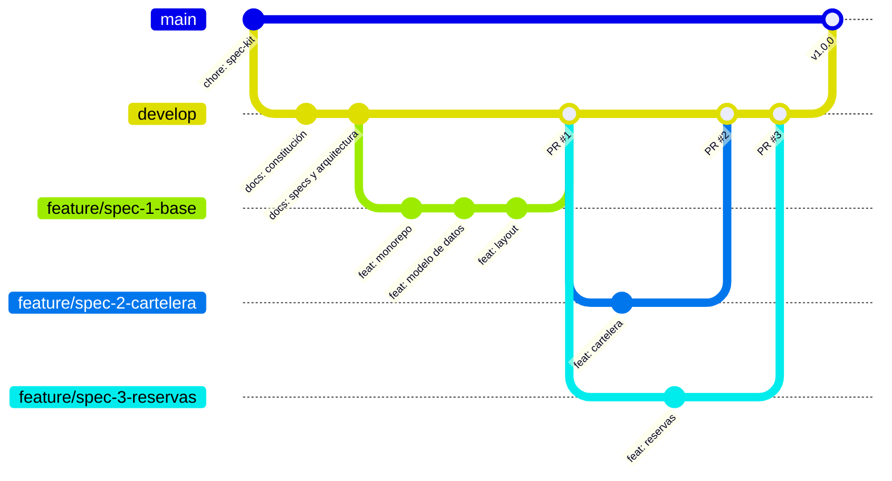

# ADR-0004: Estrategia de ramas y Specification-Driven Development

- **Estado**: Aceptado
- **Fecha**: 2026-11-18
- **Autores**: Camilo Velepucha, Cristina Feijo, Bryan Villa

## Contexto

El entregable es el **repositorio**: debe evidenciar el trabajo de cada integrante, las
decisiones tomadas y una metodología. Tres personas desarrollan en paralelo funcionalidades
que comparten modelo de datos y layout. Necesitamos:

- Saber **qué** construir antes de programar y poder revisarlo en equipo.
- Evitar que el trabajo de uno rompa el de otro.
- Trazabilidad entre requisito, tarea, commit y Pull Request.

## Decisión

### Specification-Driven Development (SDD) con GitHub Spec Kit

1. Una **constitución** (`.specify/memory/constitution.md`) fija los principios no negociables.
2. El sistema se divide en **3 specs**, uno por integrante (`specs/00N-nombre/`).
3. Cada spec sigue el flujo `/speckit-specify` → `/speckit-plan` → `/speckit-tasks` →
   `/speckit-implement`, produciendo `spec.md` (qué y por qué), `plan.md` (cómo) y
   `tasks.md` (pasos numerados).
4. El **Spec #1 (base)** se implementa primero porque define el contrato compartido
   (modelo de datos, capas, layout); los Specs #2 y #3 se implementan en paralelo después.

### Flujo de ramas (GitFlow simplificado)

- `main`: versiones estables; solo recibe PR desde `develop`.
- `develop`: integración; solo recibe PR desde `feature/*` o `fix/*`.
- `feature/spec-N-nombre`: una rama por spec y responsable.
- Commits con **Conventional Commits** en español; PR con plantilla y al menos una aprobación.
- CI en GitHub Actions (lint, tipos, pruebas, build) en cada PR.

## Alternativas consideradas

| Alternativa | A favor | En contra |
|---|---|---|
| **Trunk-based development** | Integración continua real; menos ramas | Exige feature flags y disciplina de CI alta; menos visible la autoría por spec |
| **GitFlow completo** (release/hotfix) | Muy estructurado | Ramas `release/*` y `hotfix/*` innecesarias para un prototipo sin versiones en producción |
| **GitHub Flow** (solo `main` + ramas) | Simple | Sin rama de integración, `main` quedaría inestable mientras se integran los tres specs |
| **Desarrollo sin especificación** (programar directamente) | Más rápido al inicio | Retrabajo, conflictos de modelo entre integrantes y poca evidencia de diseño |
| **Historias de usuario en issues sin Spec Kit** | Conocido | Sin plan técnico ni tareas trazables; el formato varía entre integrantes |

## Consecuencias

- **Positivas**
  - Cada integrante tiene un alcance claro y verificable (criterios de aceptación).
  - El historial de Git, los PR y los `tasks.md` marcados evidencian la contribución individual.
  - Los specs sirven de contexto para agentes de IA (Claude Code) y para DeepWiki.
- **Negativas / riesgos**
  - Escribir specs consume tiempo al inicio. Se compensa con menos retrabajo.
  - Archivos compartidos (`routes/index.ts`, `router.tsx`) pueden generar conflictos menores;
    se resuelven integrando `develop` en cada rama con frecuencia.
- **Seguimiento**: proteger `main` y `develop` en GitHub (*Settings → Branches*) exigiendo PR
  y CI en verde.
