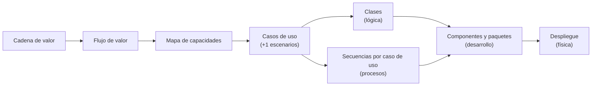
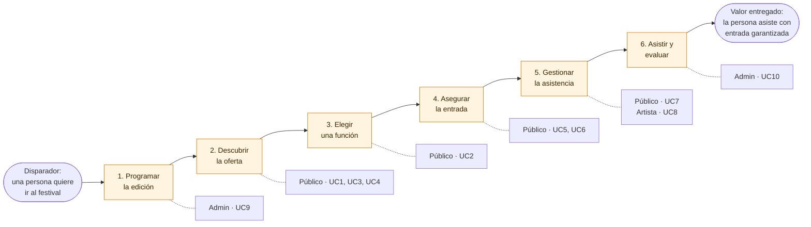
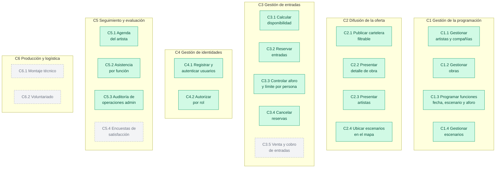

# 0. Arquitectura de negocio

**Propósito**: explicar qué valor entrega el festival y qué capacidades necesita, antes de
bajar al software. De aquí salen los casos de uso de la vista de escenarios (+1), y de ellos
las otras cuatro vistas.
**Interesados**: organización del festival, docente y equipo.

La cadena de trazabilidad que sigue toda la documentación es:

## 1. Cadena de valor

Cadena de valor de Porter adaptada a un festival de artes escénicas. Las actividades
primarias recorren el camino desde la convocatoria de artistas hasta la evaluación de la
edición. Las marcadas con **★** son las que el sistema soporta.

```mermaid
flowchart LR
    subgraph apoyo["Actividades de apoyo"]
        direction TB
        A1["Dirección y gestión del festival<br/>presupuesto, alianzas, permisos municipales"]
        A2["Gestión del talento<br/>voluntarios, técnicos, personal de sala"]
        A3["Tecnología ★<br/>plataforma web de cartelera y reservas"]
        A4["Abastecimiento<br/>escenarios, sonido, iluminación, logística"]
    end

    subgraph primarias["Actividades primarias"]
        direction LR
        P1["Curaduría y<br/>convocatoria<br/>artistas y obras"]
        P2["Programación ★<br/>funciones por fecha,<br/>hora y escenario"]
        P3["Difusión ★<br/>cartelera pública,<br/>artistas y escenarios"]
        P4["Reservas y<br/>control de aforo ★"]
        P5["Producción y<br/>ejecución de<br/>las funciones"]
        P6["Atención al público<br/>y evaluación ★<br/>cancelaciones, asistencia"]
        P1 --> P2 --> P3 --> P4 --> P5 --> P6
    end

    apoyo --> primarias
    P6 --> M(["Margen:<br/>público que asiste,<br/>salas llenas sin sobreventa,<br/>artistas con visibilidad"])

    classDef sys fill:#e0f2ff,stroke:#1f6feb,color:#0b2a4a
    class P2,P3,P4,P6,A3 sys
```

| Actividad | Qué aporta el sistema |
|---|---|
| Programación | Panel de administración para crear obras, funciones, artistas y escenarios (UC9). |
| Difusión | Cartelera con filtros, detalle de obra, artistas y escenarios con mapa (UC1–UC4). |
| Reservas y control de aforo | Reserva en línea con regla de aforo concurrente y límite de 6 entradas (UC5, UC6). |
| Atención al público y evaluación | Mis reservas y cancelación (UC7), agenda del artista (UC8), reservas por función (UC10). |
| Tecnología (apoyo) | El propio sistema: SPA React + API Express en capas ([ADR-0001](../adr/0001-estilo-arquitectonico-capas-cliente-servidor.md)). |

## 2. Flujo de valor

Flujo de valor **"Asistir a una función del festival"**, visto desde quien lo recibe, el
público. Cada etapa tiene un disparador, un resultado de valor y los actores y casos de uso
que intervienen.

| Etapa | Disparador | Resultado de valor | Capacidades (mapa) |
|---|---|---|---|
| 1. Programar la edición | Se confirman obras y artistas | Funciones publicadas con aforo válido | C1.1, C1.2, C1.3 |
| 2. Descubrir la oferta | El público entra a la web | Ve qué hay, cuándo y dónde | C2.1, C2.3, C2.4 |
| 3. Elegir una función | Le interesa una obra | Conoce sinopsis, funciones y disponibilidad | C2.2, C3.1 |
| 4. Asegurar la entrada | Decide asistir | Reserva confirmada con código `FAV-XXXXXX` | C4.1, C3.2, C3.3 |
| 5. Gestionar la asistencia | Cambia de planes / el artista quiere saber cuántos irán | Cupos liberados o asistencia esperada conocida | C3.4, C5.1 |
| 6. Asistir y evaluar | Se realiza la función | La organización conoce la asistencia por función | C5.2, C5.3 |

## 3. Mapa de capacidades

Capacidades de negocio en dos niveles. El color indica el grado en que el sistema las
cubre; las capacidades sin color quedan fuera del alcance del prototipo.

Verde: soportada por el sistema. Gris punteado: fuera del alcance (el festival es de
entrada libre con reserva, sin cobro).

### Trazabilidad capacidad → caso de uso → módulo

| Capacidad | Caso de uso | Módulo API | Spec |
|---|---|---|---|
| C1.1–C1.4 Programación | UC9 Gestionar catálogo | `admin/{artists,events,performances,venues}` | 3 |
| C2.1 Cartelera filtrable | UC1 Consultar cartelera | `performances` | 2 |
| C2.2 Detalle de obra | UC2 Ver detalle de obra | `events` | 2 |
| C2.3 Artistas | UC3 Ver artistas | `artists` | 2 |
| C2.4 Escenarios y mapa | UC4 Ver escenarios | `venues` (+ OpenStreetMap en la SPA) | 2 |
| C3.1 Disponibilidad | UC1, UC2, UC4 | `performances/availability.ts` | 2 |
| C3.2, C3.3 Reservar con aforo | UC6 Reservar entradas | `reservations` ([ADR-0006](../adr/0006-control-de-aforo.md)) | 3 |
| C3.4 Cancelar | UC7 Mis reservas | `reservations` | 3 |
| C4.1, C4.2 Identidad | UC5 Registrarse e ingresar | `auth`, `users`, `middlewares/auth` | 3 |
| C5.1 Agenda del artista | UC8 Mi agenda | `artist-agenda` | 3 |
| C5.2 Asistencia por función | UC10 Reservas de una función | `admin/performances` | 3 |
| C5.3 Auditoría | UC9 (efecto) | `lib/auditLog.ts` | 3 |
| — Resumen de la edición | Portada | `festival`, `health` | 1 |
