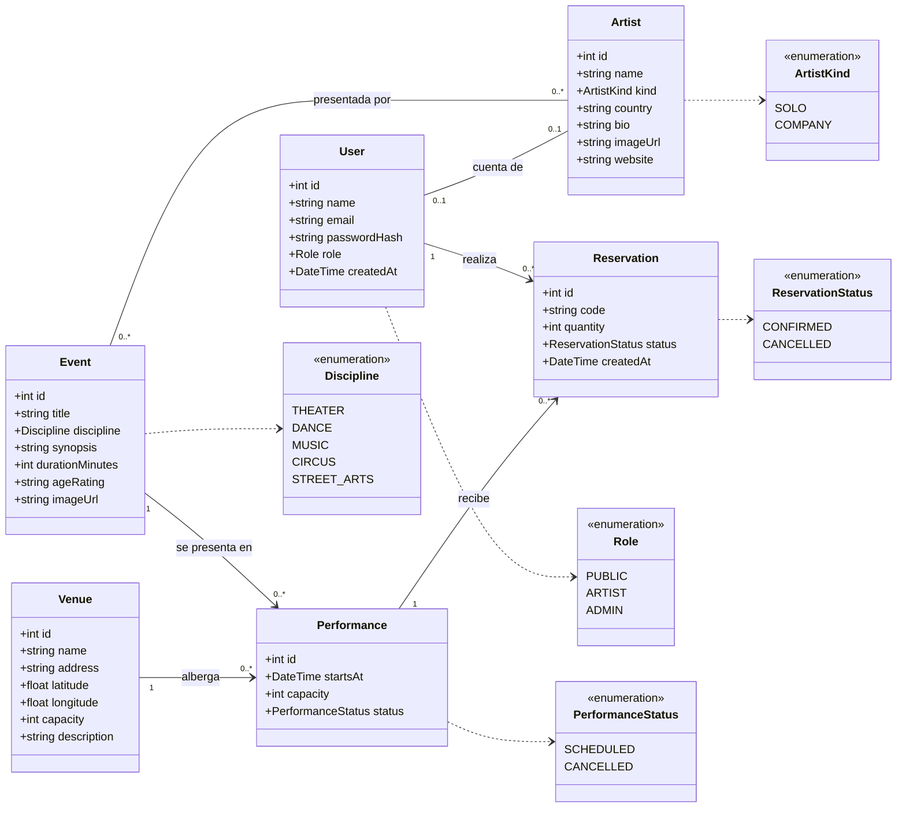

# 1. Vista lógica

**Propósito**: describir los conceptos del dominio del festival y sus relaciones,
independientemente de cómo se implementen.
**Interesados**: usuarios finales, organizadores del festival y analistas.

## Diagrama de clases del dominio

## Decisiones

- **`Event` (obra) vs. `Performance` (función).** Separamos la obra, que es el contenido
  artístico, de cada presentación concreta en fecha, hora y escenario. Una obra se presenta
  varias veces; la reserva siempre es para una **función**, no para la obra.
- **El aforo pertenece a la función**, no solo al escenario: una misma sala puede montarse
  con distinta capacidad. La regla invariante es `Performance.capacity ≤ Venue.capacity`.
- **Disponibilidad y cancelación son operaciones de servicio**, no métodos del modelo:
  `availableSeats` se deriva como `capacity − Σ quantity (reservas CONFIRMED)` y las
  cancelaciones cambian el estado sin borrar el registro.
- **Las reservas no se borran, se cancelan** (`status = CANCELLED`). Esto conserva el
  historial y hace la cancelación idempotente.
- **`Artist` y `User` son conceptos distintos**: la mayoría de artistas no necesita cuenta. El
  vínculo opcional permite que un artista con rol `ARTIST` consulte su agenda.
- **Las relaciones con dependencias se protegen al borrar**: la administración rechaza
  (`409`) eliminar un artista con obras, un escenario con funciones, una obra con funciones
  o una función con reservas, para conservar el catálogo y el historial de reservas.
- **Enumeraciones** en inglés en el código; el frontend las traduce (principio V de la
  constitución).

El detalle físico de las tablas está en
[`specs/001-base/data-model.md`](../../specs/001-base/data-model.md).
