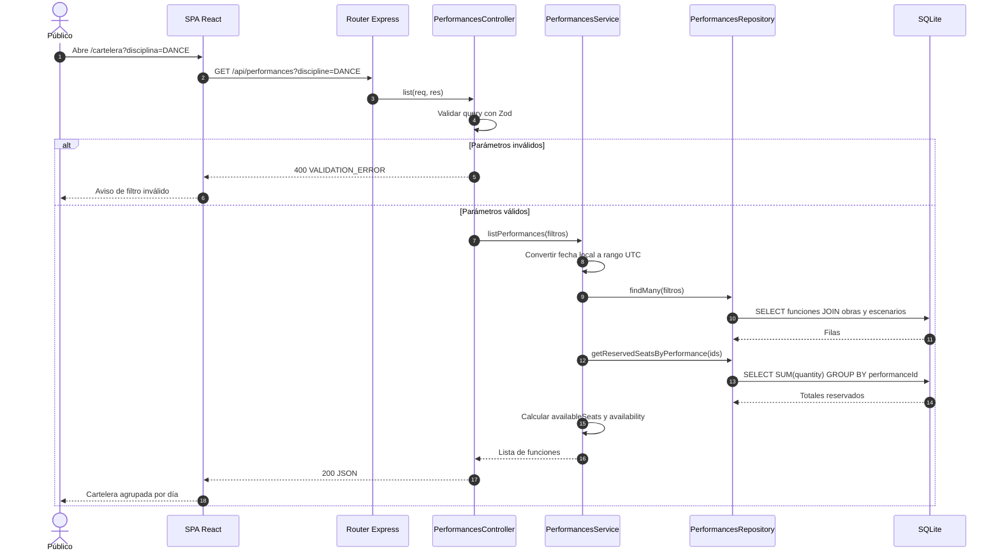
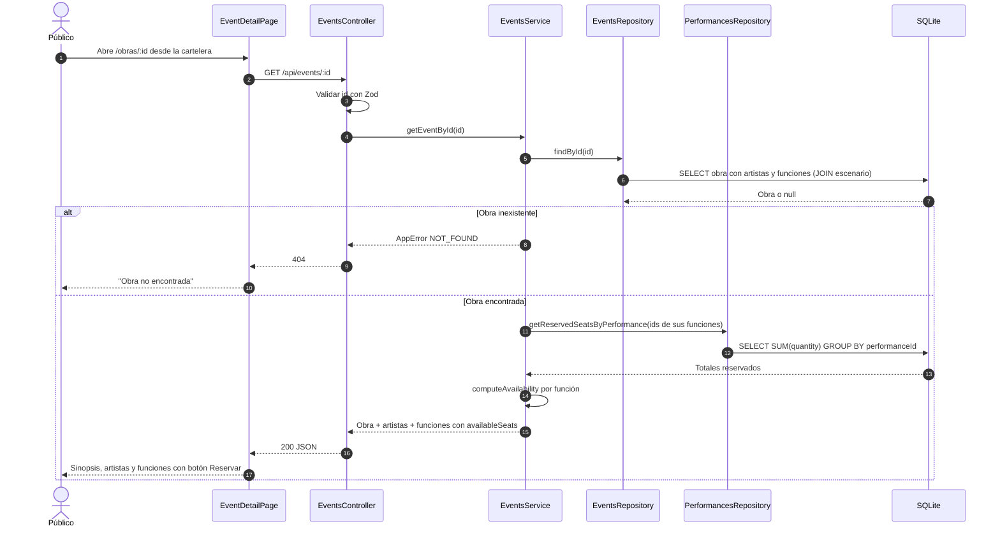
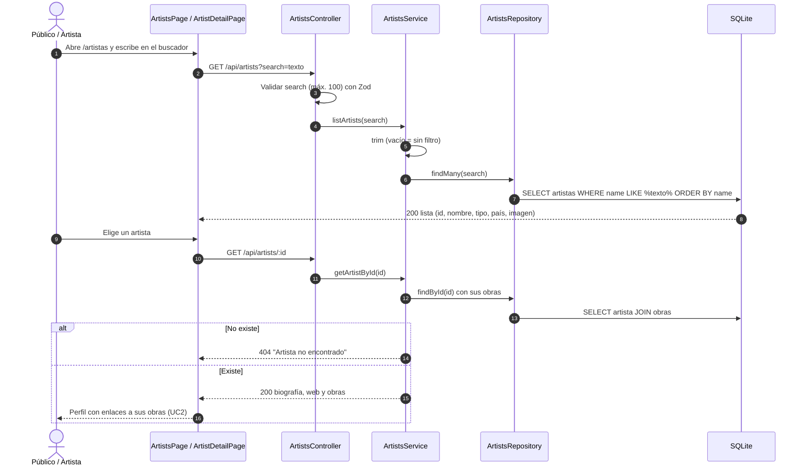
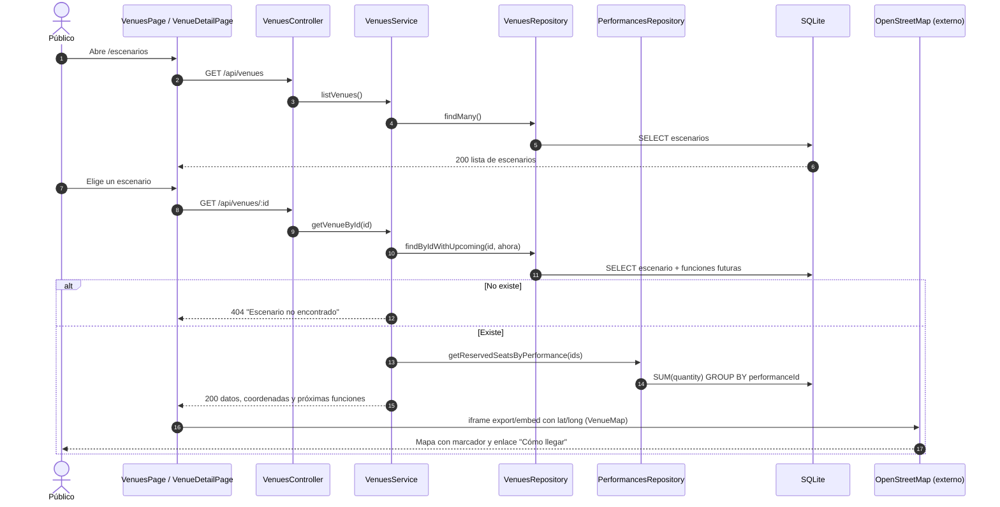
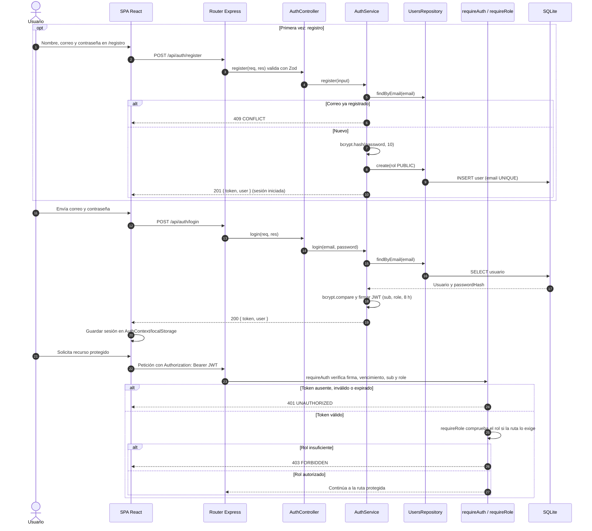
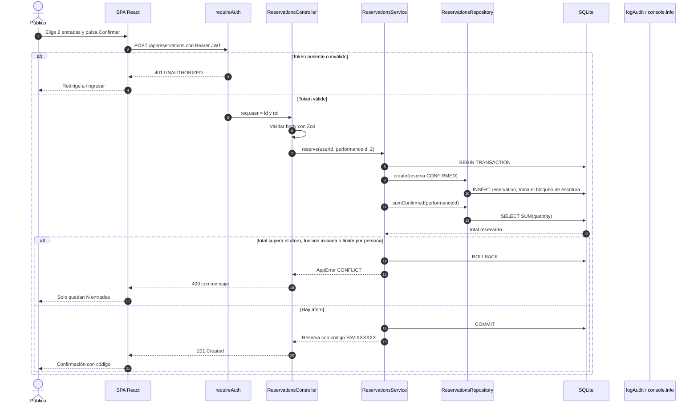
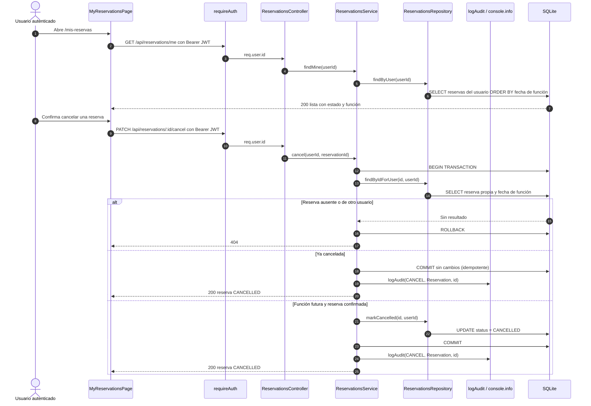
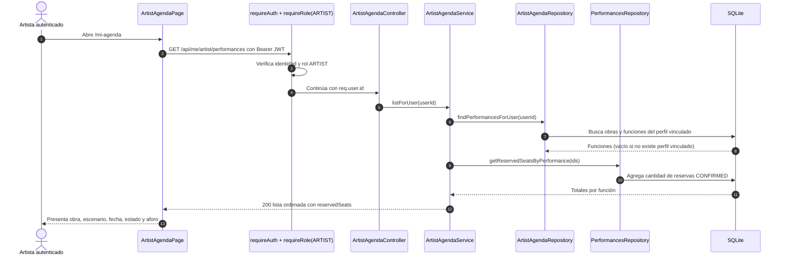
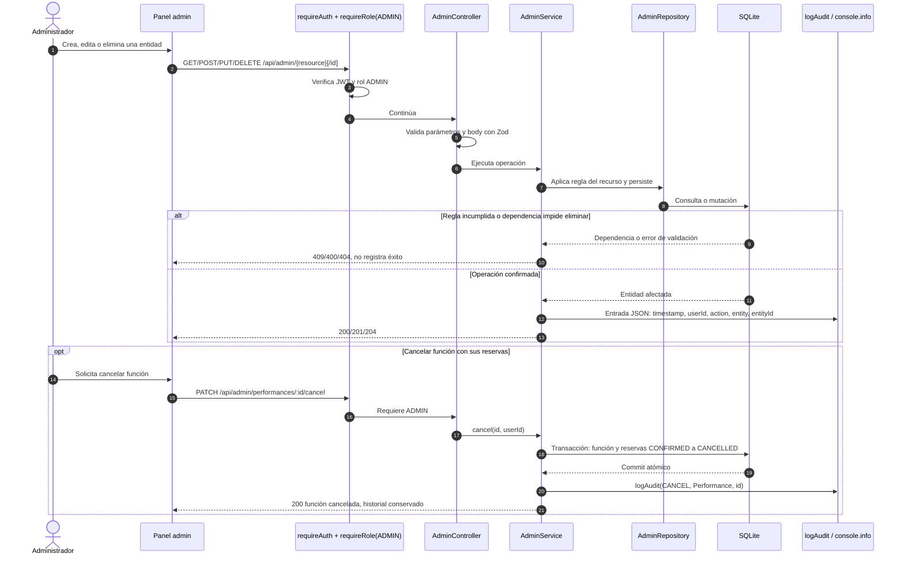
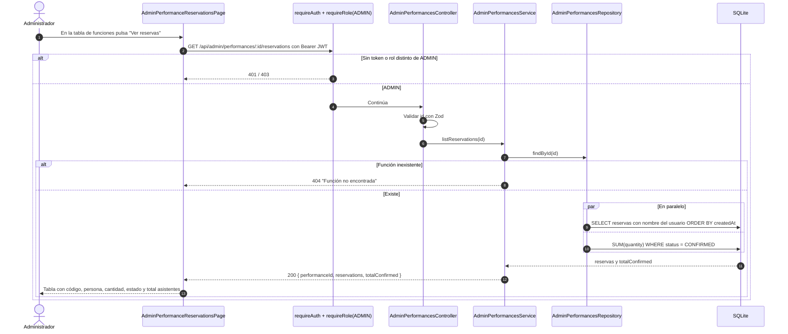

# 2. Vista de procesos

**Propósito**: mostrar cómo colaboran los componentes en tiempo de ejecución en los
flujos más importantes, incluidas la concurrencia y el manejo de errores.
**Interesados**: integradores del sistema, responsables de rendimiento y de integridad.

## Procesos en ejecución

| Proceso | Tecnología | Instancias | Comunicación |
|---|---|---|---|
| SPA | React en el navegador | Una por usuario | HTTP/JSON hacia la API |
| Servidor web de desarrollo | Vite (Node.js) | 1 | Sirve la SPA y redirige `/api` a la API (proxy) |
| API REST | Express (Node.js, un hilo con event loop) | 1 | Atiende peticiones concurrentes de forma asíncrona |
| Base de datos | SQLite (biblioteca embebida en el proceso de la API) | — | Llamadas locales vía Prisma |

## Diagramas de secuencia por caso de uso

Hay un diagrama por cada caso de uso de la [vista de escenarios](05-escenarios.md). Todos
siguen el mismo camino por capas: SPA → (middleware) → Controller (Zod) → Service (reglas)
→ Repository (Prisma) → SQLite.

| Caso de uso | Endpoint principal | Diagrama |
|---|---|---|
| UC1 Consultar cartelera | `GET /api/performances` | [UC1](#uc1--consultar-la-cartelera-con-filtros) |
| UC2 Ver detalle de obra | `GET /api/events/:id` | [UC2](#uc2--ver-el-detalle-de-una-obra) |
| UC3 Ver artistas | `GET /api/artists`, `/api/artists/:id` | [UC3](#uc3--ver-artistas-y-compañías) |
| UC4 Ver escenarios | `GET /api/venues`, `/api/venues/:id` | [UC4](#uc4--ver-escenarios-y-su-ubicación) |
| UC5 Registrarse e ingresar | `POST /api/auth/register`, `/login` | [UC5](#uc5--registrarse-iniciar-sesión-y-autorizar-una-petición) |
| UC6 Reservar entradas | `POST /api/reservations` | [UC6](#uc6--reservar-entradas) |
| UC7 Ver y cancelar mis reservas | `GET /api/reservations/me`, `PATCH …/:id/cancel` | [UC7](#uc7--ver-y-cancelar-mis-reservas) |
| UC8 Mi agenda (artista) | `GET /api/me/artist/performances` | [UC8](#uc8--consultar-la-agenda-del-artista) |
| UC9 Gestionar catálogo | `/api/admin/{venues,artists,events,performances}` | [UC9](#uc9--gestionar-el-catálogo-y-cancelar-una-función) |
| UC10 Reservas de una función | `GET /api/admin/performances/:id/reservations` | [UC10](#uc10--ver-las-reservas-de-una-función) |

### UC1 — Consultar la cartelera con filtros

### UC2 — Ver el detalle de una obra

### UC3 — Ver artistas y compañías

### UC4 — Ver escenarios y su ubicación

### UC5 — Registrarse, iniciar sesión y autorizar una petición

### UC6 — Reservar entradas

### UC7 — Ver y cancelar mis reservas

### UC8 — Consultar la agenda del artista

### UC9 — Gestionar el catálogo y cancelar una función

### UC10 — Ver las reservas de una función

## Decisiones

- **Validación en el borde** (controller con Zod) y **reglas en el service**: el service
  recibe datos ya tipados y se prueba sin HTTP.
- **Escribir primero y verificar después** dentro de la transacción. En SQLite solo hay un
  escritor a la vez; al insertar primero, la transacción toma el bloqueo de escritura y
  cualquier reserva concurrente espera. Cuando la segunda continúa, su suma ya incluye la
  primera, así que **el aforo nunca se supera**. Si la regla falla, el `ROLLBACK` deshace el
  `INSERT`.
- **Disponibilidad en una sola consulta agregada** (`GROUP BY`) para toda la cartelera,
  evitando el problema N+1.
- **Errores homogéneos**: todo error termina en el middleware `errorHandler`, que responde
  `{ error: { code, message, details } }`. El frontend solo necesita una forma de leerlos.
- **Event loop no bloqueante**: Express atiende varias peticiones a la vez mientras espera a
  la base de datos; no se necesitan hilos ni colas para la escala del festival.
