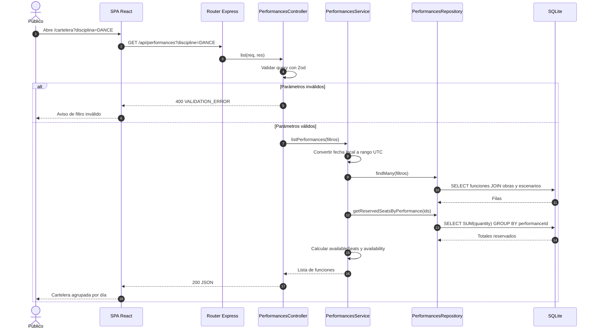
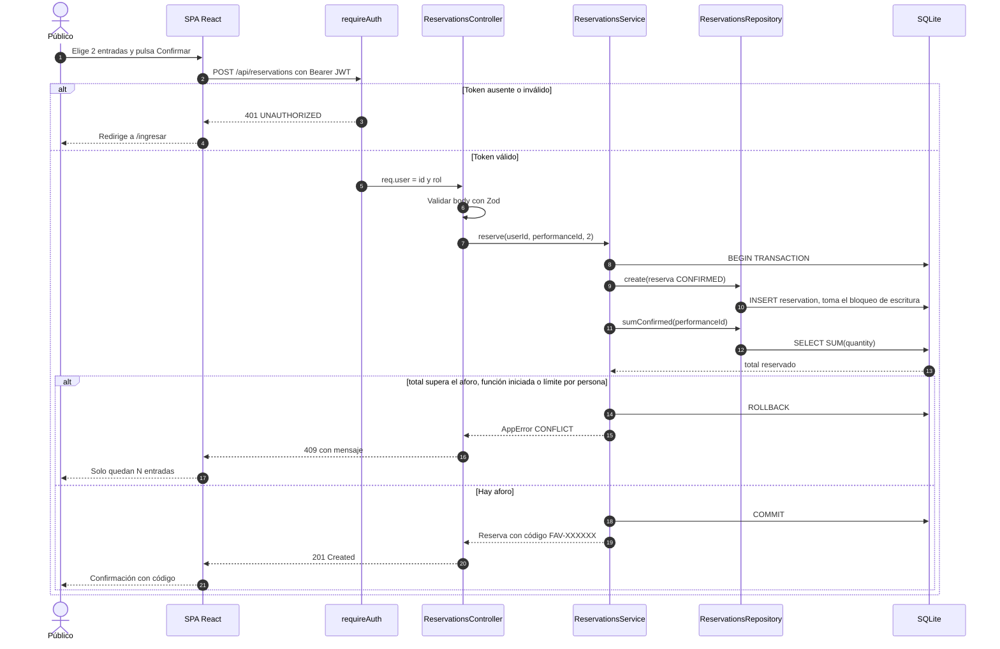

# 2. Vista de procesos

**Propósito**: mostrar cómo colaboran los componentes en tiempo de ejecución en los
flujos más importantes, incluidas la concurrencia y el manejo de errores.
**Interesados**: integradores del sistema, responsables de rendimiento y de integridad.

## Procesos en ejecución

| Proceso | Tecnología | Instancias | Comunicación |
|---|---|---|---|
| SPA | React en el navegador | Una por usuario | HTTP/JSON hacia la API |
| Servidor web de desarrollo | Vite (Node.js) | 1 | Sirve la SPA y redirige `/api` a la API (proxy) |
| API REST | Express (Node.js, un hilo con event loop) | 1 | Atiende peticiones concurrentes de forma asíncrona |
| Base de datos | SQLite (biblioteca embebida en el proceso de la API) | — | Llamadas locales vía Prisma |

## Escenario A: consultar la cartelera

## Escenario B: reservar una entrada

## Decisiones

- **Validación en el borde** (controller con Zod) y **reglas en el service**: el service
  recibe datos ya tipados y se prueba sin HTTP.
- **Escribir primero y verificar después** dentro de la transacción. En SQLite solo hay un
  escritor a la vez; al insertar primero, la transacción toma el bloqueo de escritura y
  cualquier reserva concurrente espera. Cuando la segunda continúa, su suma ya incluye la
  primera, así que **el aforo nunca se supera**. Si la regla falla, el `ROLLBACK` deshace el
  `INSERT`.
- **Disponibilidad en una sola consulta agregada** (`GROUP BY`) para toda la cartelera,
  evitando el problema N+1.
- **Errores homogéneos**: todo error termina en el middleware `errorHandler`, que responde
  `{ error: { code, message, details } }`. El frontend solo necesita una forma de leerlos.
- **Event loop no bloqueante**: Express atiende varias peticiones a la vez mientras espera a
  la base de datos; no se necesitan hilos ni colas para la escala del festival.
