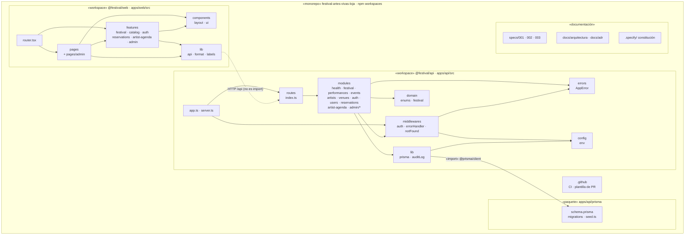
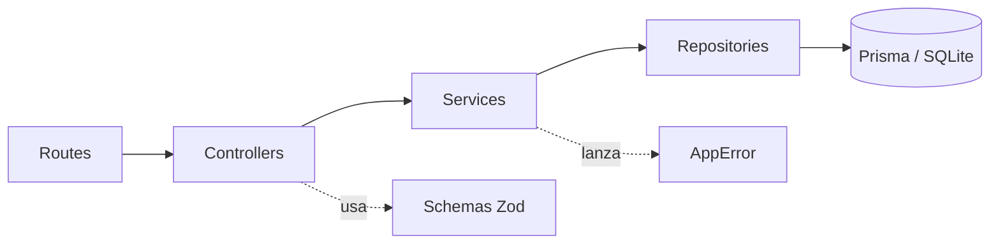
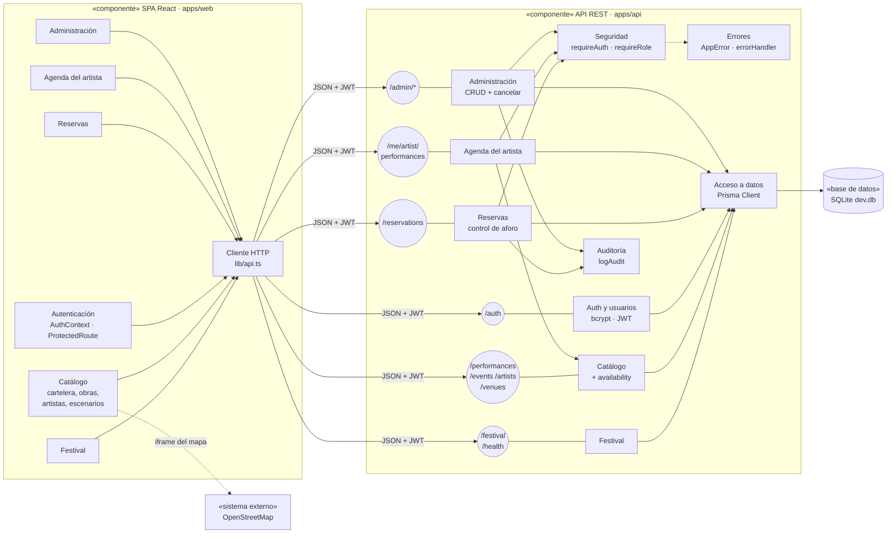
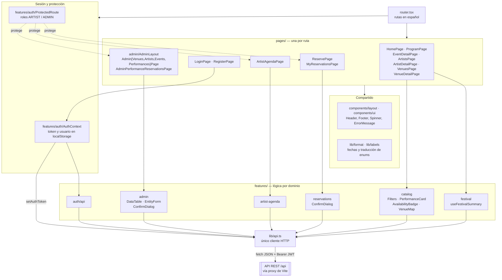

# 3. Vista de desarrollo

**Propósito**: mostrar cómo se organiza el código fuente en paquetes, módulos y capas, y
qué reglas de dependencia deben respetarse.
**Interesados**: programadores del equipo y de futuros mantenimientos.

## Diagrama de paquetes

Paquetes del monorepo y sus dependencias «import». Las flechas van siempre en un solo
sentido, de la interfaz hacia los datos; ningún paquete inferior conoce a uno superior.

| Paquete | Contiene | Depende de |
|---|---|---|
| `web/pages` | Una página por ruta | `features`, `components`, `lib` |
| `web/features` | Llamadas a la API y componentes de cada dominio | `components`, `lib` |
| `web/lib` | `api.ts` (único cliente HTTP), formato y etiquetas | — |
| `api/routes` | Montaje de routers por recurso | `modules` |
| `api/modules/<recurso>` | `routes → controller → service → repository` | `middlewares`, `errors`, `domain`, `lib` |
| `api/lib` | Cliente Prisma y `logAudit` | `config`, `prisma/schema` |

## Reglas de dependencia entre capas

| Capa | Responsabilidad | Puede depender de | No puede |
|---|---|---|---|
| Routes | Asociar método y ruta a un controller y middlewares | Controllers, middlewares | Contener lógica |
| Controllers | Validar entrada (Zod), invocar el service, elegir el código HTTP | Services, schemas | Acceder a Prisma |
| Services | Reglas de negocio y transacciones | Repositories, domain, `AppError` | Conocer `req`/`res` |
| Repositories | Consultas a la base de datos | `lib/prisma.ts` | Contener reglas de negocio |

## Módulos por spec

| Módulo API | Módulo web | Spec |
|---|---|---|
| `health`, `festival` | `components/layout`, `pages/HomePage` | 1 |
| `performances`, `events`, `artists`, `venues` | `features/catalog`, páginas de cartelera | 2 |
| `auth`, `users`, `reservations`, `admin/{venues,artists,events,performances}` | `features/auth`, `features/reservations`, `features/admin`, `pages/admin/*` | 3 |
| `artist-agenda` (consume el repositorio de funciones públicas para disponibilidad reservada) | `features/artist-agenda`, `pages/ArtistAgendaPage.tsx` | 3 |

## Diagrama de componentes del sistema

Componentes desplegables y las interfaces que ofrecen (○) y consumen. Cada *feature* del
frontend consume exactamente una interfaz REST de la API a través de `lib/api.ts`.

## Componentes internos del frontend

La SPA también está en capas: las páginas componen la interfaz, cada *feature* encapsula
las llamadas de su dominio y **todas** las peticiones pasan por `lib/api.ts`, que añade el
token JWT y traduce el formato de error común de la API.

## Decisiones

- **Organización por módulo y luego por capa** (`modules/events/events.service.ts`) en
  lugar de carpetas globales `controllers/`, `services/`. Cada spec agrega carpetas nuevas en
  vez de editar las mismas, lo que reduce los conflictos de merge entre ramas.
- **`app.ts` separado de `server.ts`**: la app Express se puede importar en las pruebas con
  Supertest sin abrir un puerto.
- **Un solo cliente HTTP** en el frontend (`lib/api.ts`), que centraliza la URL base, el
  token y el formato de error.
- **Monorepo con npm workspaces**: un solo `npm install`, scripts comunes y versiones
  coherentes ([ADR-0005](../adr/0005-monorepo-npm-workspaces.md)).
- **Pruebas junto a cada app** (`apps/api/tests`, `apps/web/src/test`) con Vitest en ambas, un
  solo framework para todo el equipo.
