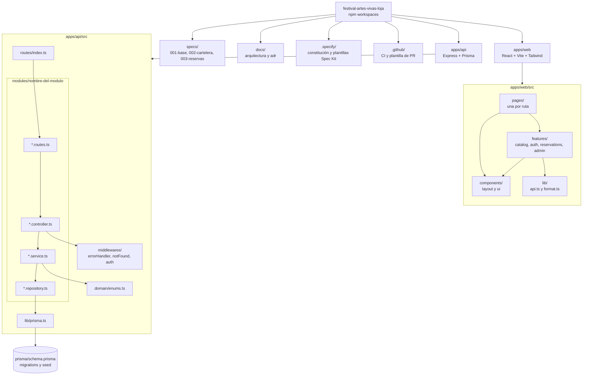
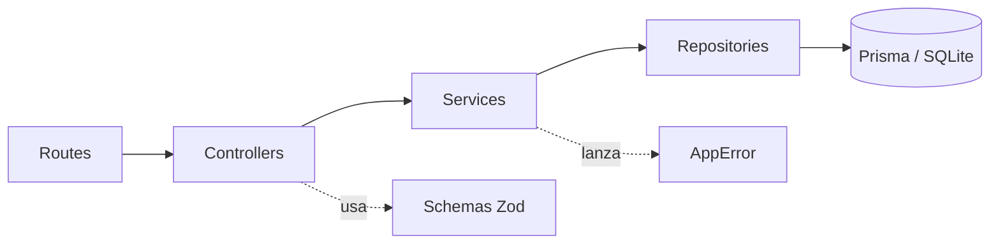

# 3. Vista de desarrollo

**Propósito**: mostrar cómo se organiza el código fuente en paquetes, módulos y capas, y
qué reglas de dependencia deben respetarse.
**Interesados**: programadores del equipo y de futuros mantenimientos.

## Organización del repositorio

## Reglas de dependencia entre capas

| Capa | Responsabilidad | Puede depender de | No puede |
|---|---|---|---|
| Routes | Asociar método y ruta a un controller y middlewares | Controllers, middlewares | Contener lógica |
| Controllers | Validar entrada (Zod), invocar el service, elegir el código HTTP | Services, schemas | Acceder a Prisma |
| Services | Reglas de negocio y transacciones | Repositories, domain, `AppError` | Conocer `req`/`res` |
| Repositories | Consultas a la base de datos | `lib/prisma.ts` | Contener reglas de negocio |

## Módulos por spec

| Módulo API | Módulo web | Spec |
|---|---|---|
| `health`, `festival` | `components/layout`, `pages/HomePage` | 1 |
| `performances`, `events`, `artists`, `venues` | `features/catalog`, páginas de cartelera | 2 |
| `auth`, `users`, `reservations`, `admin/*` | `features/auth`, `features/reservations`, `features/admin` | 3 |

## Decisiones

- **Organización por módulo y luego por capa** (`modules/events/events.service.ts`) en
  lugar de carpetas globales `controllers/`, `services/`. Cada spec agrega carpetas nuevas en
  vez de editar las mismas, lo que reduce los conflictos de merge entre ramas.
- **`app.ts` separado de `server.ts`**: la app Express se puede importar en las pruebas con
  Supertest sin abrir un puerto.
- **Un solo cliente HTTP** en el frontend (`lib/api.ts`), que centraliza la URL base, el
  token y el formato de error.
- **Monorepo con npm workspaces**: un solo `npm install`, scripts comunes y versiones
  coherentes ([ADR-0005](../adr/0005-monorepo-npm-workspaces.md)).
- **Pruebas junto a cada app** (`apps/api/tests`, `apps/web/src/test`) con Vitest en ambas, un
  solo framework para todo el equipo.
