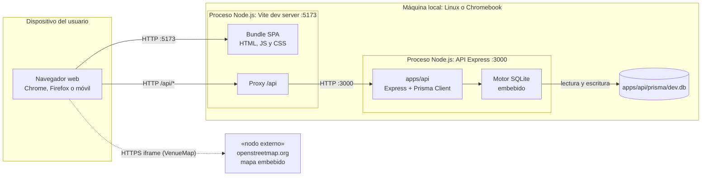
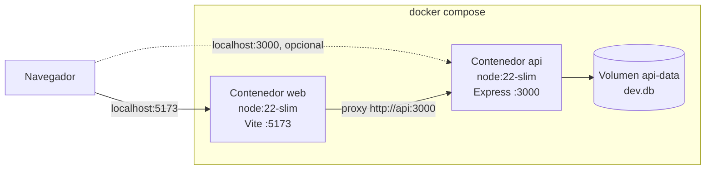

# 4. Vista física

**Propósito**: mostrar en qué nodos de hardware y software se ejecuta cada componente y
cómo se comunican.
**Interesados**: quien instala y opera el sistema (en este proyecto, el propio equipo).

## Diagrama de despliegue: local (modo desarrollo)

Es el entorno objetivo del prototipo: todo corre en la máquina del desarrollador, incluida
una Chromebook con el entorno Linux activado.

| Nodo | Artefacto desplegado | Puerto / protocolo |
|---|---|---|
| Dispositivo del usuario | Navegador que ejecuta la SPA | HTTP hacia :5173 |
| Proceso Vite | `apps/web` (bundle en memoria) y proxy `/api` | :5173 |
| Proceso API | `apps/api` con `tsx` y Prisma Client | :3000 |
| Archivo | `apps/api/prisma/dev.db` (SQLite) | E/S de archivo local |
| OpenStreetMap | Mapa de escenarios (externo, sin datos del usuario) | HTTPS |

## Despliegue alternativo con Docker Compose (opcional)

## Despliegue hacia producción (referencia, fuera del alcance)

Si el festival quisiera publicar el sistema, la misma arquitectura se mapearía así sin
cambiar el código de las capas:

| Componente | Local | Producción sugerida |
|---|---|---|
| SPA | Vite dev server | Archivos estáticos (`vite build`) en un CDN o Nginx |
| API | `tsx watch` | `node dist/server.js` detrás de un proxy inverso con HTTPS |
| Base de datos | SQLite en archivo | PostgreSQL gestionado (cambiar `provider` en Prisma) |

## Decisiones

- **SQLite embebido en el proceso de la API**: no hay servidor de base de datos que instalar;
  el archivo `dev.db` se regenera con `npm run db:setup`. Ver
  [ADR-0003](../adr/0003-base-de-datos-sqlite-prisma.md).
- **Proxy de Vite** para `/api`: el navegador ve un único origen en desarrollo, así que no
  hay problemas de CORS. Igual se configura `CORS_ORIGIN` para cuando se llame a la API
  directamente.
- **Docker es opcional**: en una Chromebook Docker consume muchos recursos; el camino
  principal es `npm run dev`.
- **Puertos configurables** por variables de entorno (`PORT`, `VITE_API_PROXY_TARGET`).
