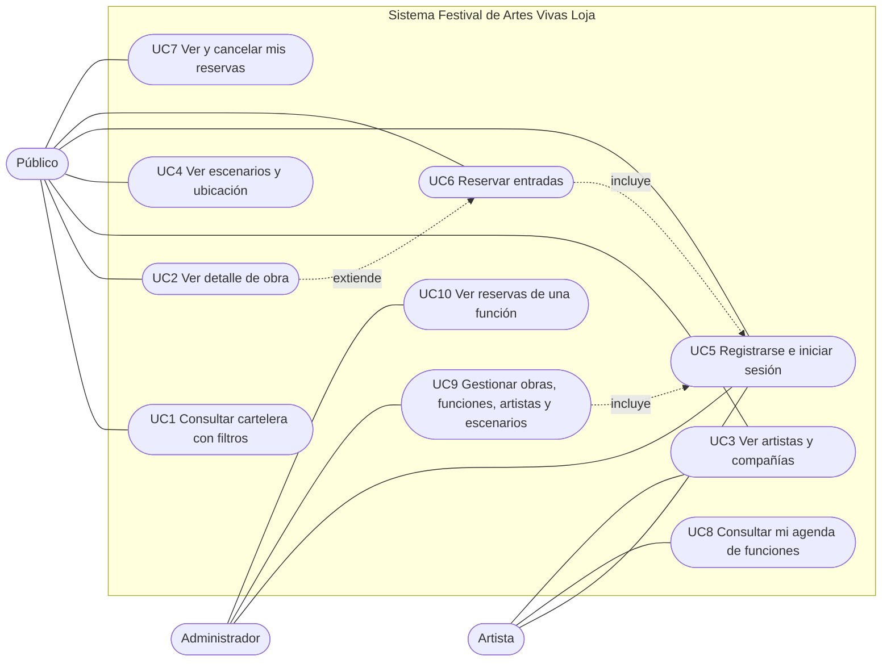

# 5. Escenarios (+1)

**Propósito**: describir los casos de uso principales que motivan la arquitectura y
mostrar cómo cada uno recorre las otras cuatro vistas. Sirven para validar que las vistas
son coherentes entre sí.
**Interesados**: todos (usuarios, equipo y docente).

## Casos de uso

Los casos de uso salen del [mapa de capacidades](00-arquitectura-de-negocio.md#3-mapa-de-capacidades)
y cada uno tiene su [diagrama de secuencia](02-vista-procesos.md#diagramas-de-secuencia-por-caso-de-uso).

| Caso de uso | Actor | Spec | Prioridad |
|---|---|---|---|
| UC1 Consultar cartelera | Público | 2 | P1 |
| UC2 Ver detalle de obra | Público | 2 | P1 |
| UC3 Ver artistas | Público, Artista | 2 | P2 |
| UC4 Ver escenarios | Público | 2 | P2 |
| UC5 Registrarse / ingresar | Todos | 3 | P1 |
| UC6 Reservar entradas | Público | 3 | P1 |
| UC7 Mis reservas | Público | 3 | P2 |
| UC8 Agenda del artista | Artista | 3 | P3 |
| UC9 Gestionar catálogo | Administrador | 3 | P2 |
| UC10 Reservas de una función | Administrador | 3 | P2 |

## Recorrido de los escenarios por las cuatro vistas

### Escenario 1 — Público: "¿Qué obras de danza hay el sábado en el Teatro Bolívar?" (UC1 → UC2)

| Vista | Qué elementos intervienen |
|---|---|
| **Lógica** | `Performance` filtrada por fecha; su `Event` (disciplina `DANCE`) y su `Venue`; `availableSeats()` derivado de `Reservation`. |
| **Procesos** | Secuencia *Consultar la cartelera*: SPA → Controller (Zod) → Service (rango UTC, disponibilidad) → Repository (dos consultas). |
| **Desarrollo** | `pages/ProgramPage.tsx` → `features/catalog/api.ts` → `lib/api.ts`; en la API, `modules/performances/*`. |
| **Física** | Navegador → Vite :5173 (proxy) → API :3000 → `dev.db`. |

### Escenario 2 — Público: "Reservar 2 entradas para *Raíces*" (UC5 → UC6 → UC7)

| Vista | Qué elementos intervienen |
|---|---|
| **Lógica** | `User` crea una `Reservation` para una `Performance`; invariante `Σ quantity ≤ capacity`. |
| **Procesos** | `POST /api/reservations` exige JWT válido con `requireAuth`; el service crea y valida en una transacción, que revierte si no hay aforo. `409` en ese caso. |
| **Desarrollo** | `pages/ReservePage.tsx`, `features/auth/AuthContext.tsx`, `features/reservations/api.ts`; `modules/reservations/*`, `middlewares/auth.ts`. |
| **Física** | El bloqueo de escritura de SQLite (un único proceso de API) garantiza la serialización. |

### Escenario 3 — Artista: "¿Cuántas personas reservaron para mi función?" (UC5 → UC8)

| Vista | Qué elementos intervienen |
|---|---|
| **Lógica** | `User` con rol `ARTIST` vinculado a un `Artist` → sus `Event` → `Performance` → reservas confirmadas. |
| **Procesos** | `GET /api/me/artist/performances` pasa por `requireAuth` y `requireRole('ARTIST')`; el service filtra por el `userId` vinculado al perfil y agrega entradas confirmadas por función. Sin perfil vinculado devuelve una lista vacía. |
| **Desarrollo** | `pages/ArtistAgendaPage.tsx`, `features/artist-agenda/api.ts`; `modules/artist-agenda/*`. |
| **Física** | Igual que el escenario 1. |

### Escenario 4 — Administrador: "Programar una función nueva y revisar su asistencia" (UC9 → UC10)

| Vista | Qué elementos intervienen |
|---|---|
| **Lógica** | Crear `Performance` para un `Event` existente en un `Venue`; regla `capacity ≤ venue.capacity`. El CRUD rechaza eliminar artistas con obras, escenarios u obras con funciones y funciones con reservas (`409`). Para estas últimas se ofrece cancelación, que marca la función y sus reservas confirmadas sin borrar registros. |
| **Procesos** | `/api/admin/*` aplica `requireAuth` y `requireRole('ADMIN')`; controller valida con Zod, service aplica reglas en transacción y repository persiste. Las mutaciones exitosas escriben una entrada estructurada de auditoría en `console.info`; los errores no se registran como exitosos. |
| **Desarrollo** | `pages/admin/*`, `features/admin/api.ts`, componentes `{DataTable,EntityForm,ConfirmDialog}`; `modules/admin/{venues,artists,events,performances}/*`. La página de reservas de función usa `GET /api/admin/performances/:id/reservations`. |
| **Física** | Igual que el escenario 1; la nueva función aparece de inmediato en la cartelera pública. |

### Escenario 5 — Usuario: iniciar sesión y acceder según su rol (UC5)

| Vista | Qué elementos intervienen |
|---|---|
| **Lógica** | `User` tiene uno de los roles `PUBLIC`, `ARTIST` o `ADMIN`; el perfil `Artist` asociado es opcional. |
| **Procesos** | `POST /api/auth/login` verifica contraseña con bcrypt y devuelve JWT firmado con `sub` y `role`, válido 8 horas. `requireAuth` verifica el Bearer token; `requireRole` permite solo el rol exigido. El frontend protege `/mi-agenda` para `ARTIST` y `/admin/*` para `ADMIN`. |
| **Desarrollo** | `modules/auth/*`, `middlewares/auth.ts`, `features/auth/{AuthContext,ProtectedRoute}.tsx`, `pages/LoginPage.tsx` y `router.tsx`. |
| **Física** | El JWT circula en la cabecera `Authorization` entre navegador y API; los datos de usuario se consultan mediante Prisma/SQLite. |

### Escenario 6 — Público: cancelar una reserva propia (UC7)

| Vista | Qué elementos intervienen |
|---|---|
| **Lógica** | La `Reservation` conserva su registro y cambia de `CONFIRMED` a `CANCELLED`; solo su propietario puede cancelarla y solo antes del inicio de la función. |
| **Procesos** | `PATCH /api/reservations/:id/cancel` requiere sesión, consulta la reserva por `reservationId` y `userId` dentro de la transacción, y devuelve `404` si no es propia o no existe. Una cancelación repetida es idempotente. |
| **Desarrollo** | `pages/MyReservationsPage.tsx`, `features/reservations/api.ts`; `modules/reservations/*` y `middlewares/auth.ts`. |
| **Física** | La actualización de estado se confirma en SQLite; la disponibilidad pública vuelve a contar solo reservas confirmadas. |

### Escenario 7 — Administrador: cancelar una función (UC9)

| Vista | Qué elementos intervienen |
|---|---|
| **Lógica** | `Performance.status` pasa a `CANCELLED`; sus reservas confirmadas también cambian a `CANCELLED` y permanecen almacenadas. |
| **Procesos** | `PATCH /api/admin/performances/:id/cancel` requiere JWT y rol `ADMIN`; el service actualiza función y reservas en la misma transacción. Al completar, `logAudit` emite `userId`, acción `CANCEL`, entidad, id y fecha/hora a `console.info`. |
| **Desarrollo** | `pages/admin/AdminPerformancesPage.tsx`, `features/admin/api.ts`, `modules/admin/performances/*`, `lib/auditLog.ts`. |
| **Física** | La transacción se ejecuta en la API contra el archivo SQLite; no existe un almacén de auditoría separado. |

## Validación cruzada

| Pregunta | Respuesta y vista que la garantiza |
|---|---|
| ¿Cada entidad lógica tiene dónde persistirse? | Sí: las 6 clases están en `schema.prisma` (lógica ↔ desarrollo). |
| ¿Cada caso de uso tiene un endpoint y una pantalla? | Sí: ver los contratos en los `plan.md` de cada spec (escenarios ↔ desarrollo). |
| ¿La regla crítica de aforo resiste la concurrencia? | Sí: transacción con escritura primero sobre un único escritor SQLite (procesos ↔ física). |
| ¿Corre en el entorno del equipo? | Sí: dos procesos Node.js y un archivo SQLite, sin servicios externos (física). |
