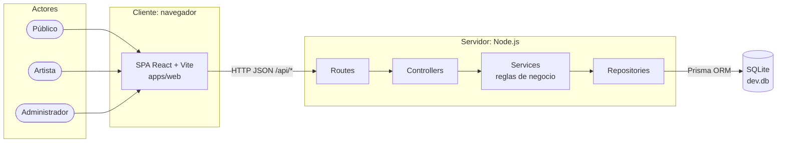
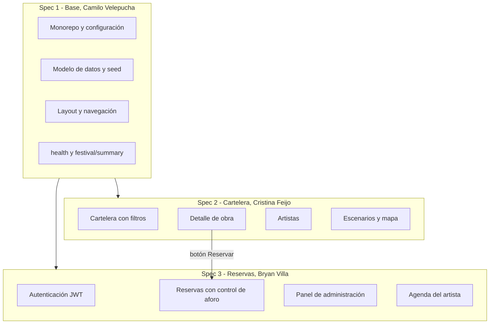

# Arquitectura del sistema — Modelo 4+1 vistas

Documentamos la arquitectura con el modelo **4+1 vistas de Philippe Kruchten (1995)**. Cada
vista responde a las preocupaciones de un grupo de interesados distinto, y la vista "+1"
(escenarios) las une y valida.

| # | Vista | Pregunta que responde | Interesados | Diagrama | Archivo |
|---|---|---|---|---|---|
| 1 | Lógica | ¿Qué conceptos maneja el sistema y cómo se relacionan? | Usuarios finales, analistas | Clases y estados | [01-vista-logica.md](01-vista-logica.md) |
| 2 | Procesos | ¿Cómo colaboran los componentes en tiempo de ejecución? | Integradores, rendimiento | Secuencia | [02-vista-procesos.md](02-vista-procesos.md) |
| 3 | Desarrollo | ¿Cómo está organizado el código? | Programadores | Módulos, capas y componentes del frontend | [03-vista-desarrollo.md](03-vista-desarrollo.md) |
| 4 | Física | ¿Dónde se ejecuta cada componente? | Operaciones | Despliegue | [04-vista-fisica.md](04-vista-fisica.md) |
| +1 | Escenarios | ¿Qué casos de uso guían y validan las otras vistas? | Todos | Casos de uso | [05-escenarios.md](05-escenarios.md) |

Las decisiones que dan forma a estas vistas están registradas como ADR en
[`../adr/`](../adr/README.md).

## Vista general del sistema

Arquitectura **cliente-servidor** con un backend **en capas**. El navegador descarga una
SPA de React que consume una API REST en Express; la API es la única que accede a la base
de datos SQLite a través de Prisma.

## Módulos funcionales y spec responsable

## Atributos de calidad priorizados

| Atributo | Cómo lo atiende la arquitectura |
|---|---|
| **Integridad** (no sobrevender el aforo) | Regla en el service de reservas, ejecutada dentro de una transacción ([Spec #3](../../specs/003-reservas/plan.md)). |
| **Mantenibilidad** | Capas con dependencias en un solo sentido; módulos por recurso; ADR. |
| **Facilidad de ejecución local** | SQLite en archivo, npm workspaces, un solo `npm run dev` ([ADR-0003](../adr/0003-base-de-datos-sqlite-prisma.md)). |
| **Accesibilidad** | Principio IV de la constitución; HTML semántico y navegación por teclado. |
| **Trabajo en paralelo del equipo** | Un spec por integrante, ramas independientes, archivos compartidos mínimos ([ADR-0004](../adr/0004-estrategia-de-ramas-y-sdd.md)). |
