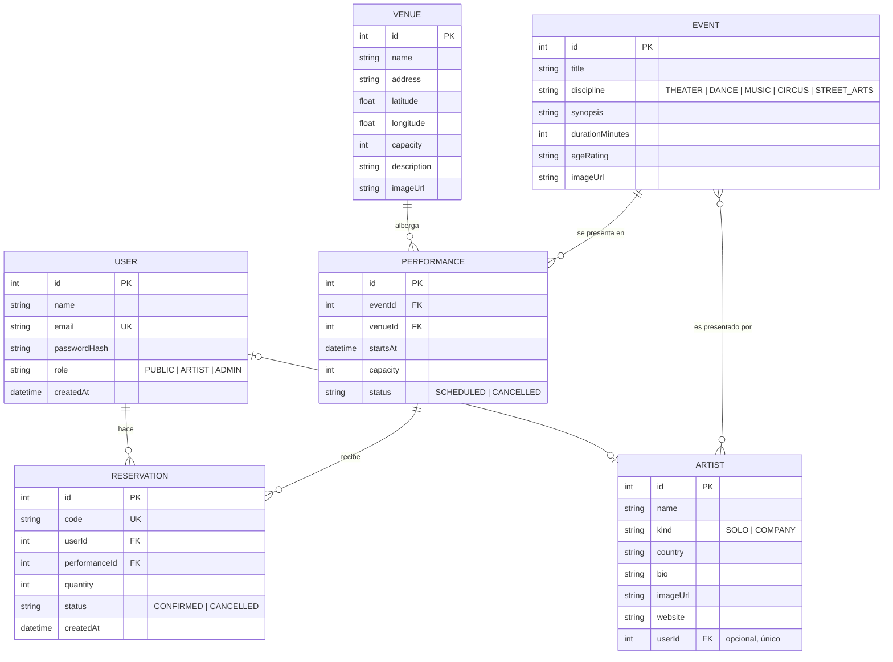

# Modelo de datos — Spec #1

Fuente de verdad: `apps/api/prisma/schema.prisma`. Este documento explica el modelo; si
difieren, manda el esquema.

## Diagrama entidad-relación

## Decisiones

| Decisión | Motivo |
|---|---|
| Valores enumerados como `String` + constantes en `src/domain/enums.ts` | Portabilidad entre motores (SQLite hoy, PostgreSQL mañana) y validación centralizada en el código. |
| `Performance.capacity` propio (no se usa directamente `Venue.capacity`) | Una función puede usar solo parte del escenario (por ejemplo, un montaje en semicírculo). El seed lo inicializa con la capacidad del escenario o menos. |
| El aforo disponible **no se guarda** | Se calcula: `capacity − Σ quantity` de reservas `CONFIRMED`. Así no hay dos fuentes de verdad (lo implementa el Spec #3 dentro de una transacción). |
| `Reservation.code` único y legible (`FAV-XXXXXX`) | Es lo que el asistente muestra en la puerta del escenario. |
| Relación `Event ↔ Artist` muchos-a-muchos implícita | Una obra puede tener varias compañías (coproducciones) y una compañía varias obras. |
| `Artist.userId` opcional | Permite que un artista tenga cuenta para ver sus funciones, sin obligar a todos a tenerla. |
| Borrado en cascada `Event → Performance` y `Performance → Reservation` | Evita registros huérfanos. El Spec #3 debe impedir borrar funciones con reservas confirmadas (regla de negocio en el service). |
| Fechas en UTC | Prisma/SQLite guardan UTC; el frontend formatea en `America/Guayaquil`. |

## Reglas de validación compartidas

- `User.email`: único, en minúsculas.
- `Venue.capacity`, `Performance.capacity`: enteros > 0; `Performance.capacity ≤ Venue.capacity`.
- `Reservation.quantity`: entero entre 1 y 6 por reserva.
- `Event.durationMinutes`: entero > 0.
